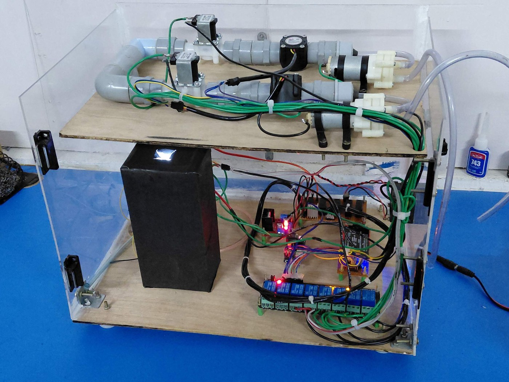
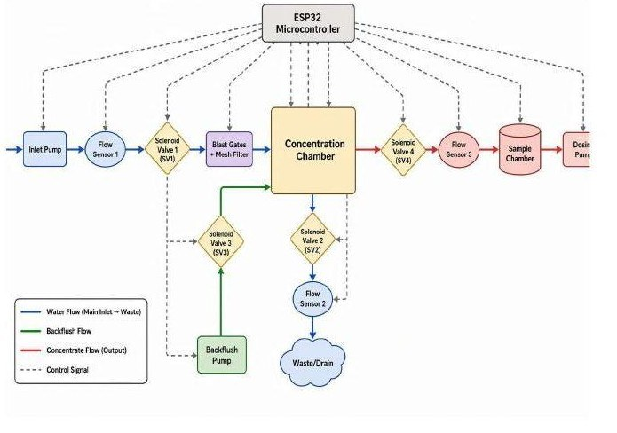
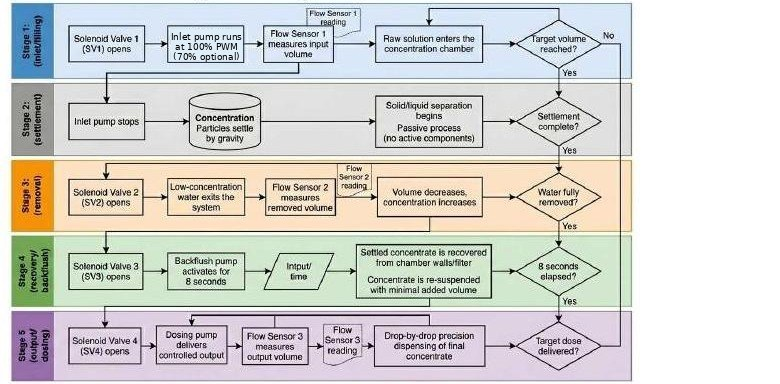
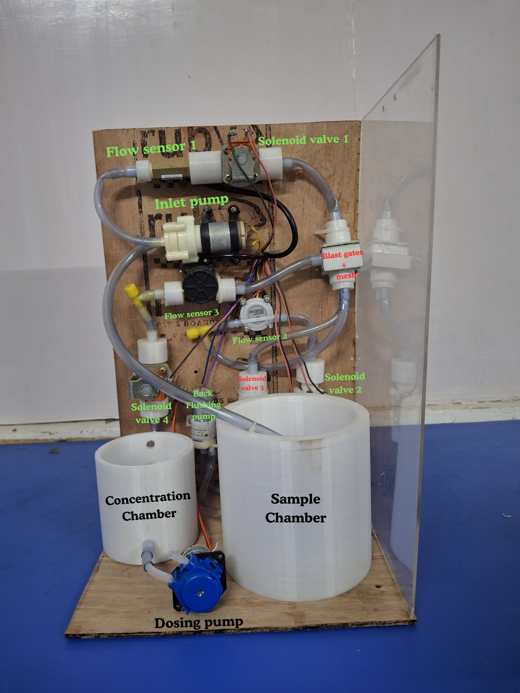
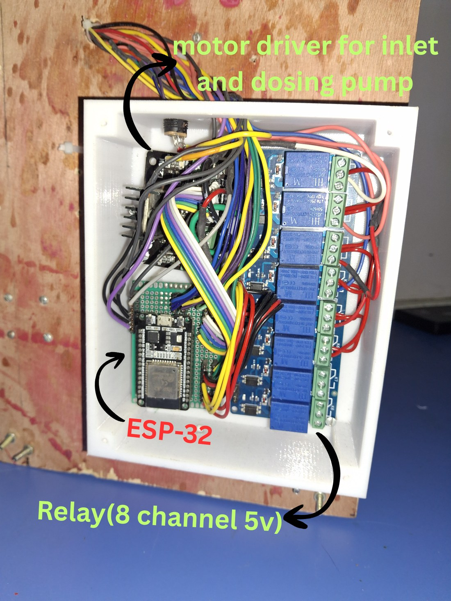
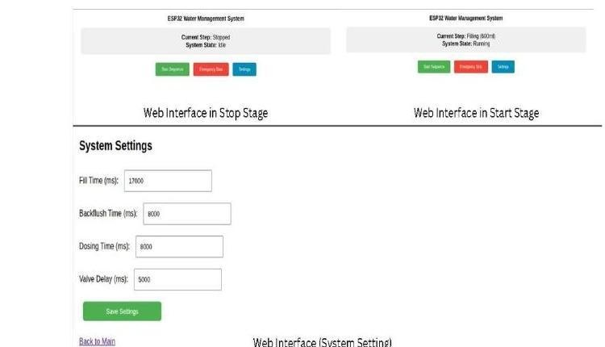
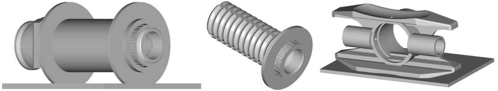
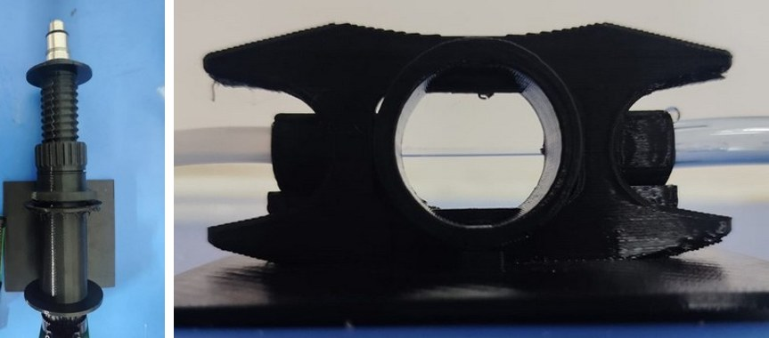
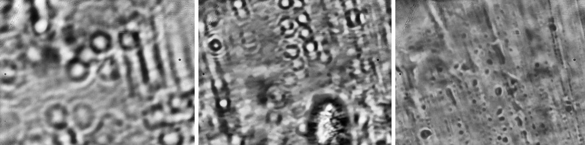

# Low-Cost Automated Sample Concentrator with 3D-Printed Microscope

A two-module, low-cost platform for concentrating dilute water samples and imaging them:

- **Module A: 3D-printed helical focuser microscope tube.** A Hadley-derived helical focuser with an RMS mount adapter that carries a 45x / 0.65 NA finite-conjugate objective (160/0.17). It uses a non-rotating slot-and-rib tube, black PLA parts, a flexible cyanoacrylate focus lock and a slider that switches between an open-top viewing position and a flow-cell position.
- **Module B: ESP32 automated concentrator with backflush recovery.** Four normally closed solenoid valves, three Hall-effect flow sensors, inlet/backflush/dosing pumps and a self-hosted web interface, at roughly **US$75** in components.
- **Vision-coupled chamber.** A camera on the concentration chamber takes continuous photos, so any water or other liquid that has been concentrated can be viewed directly.

Paper: *Integrated Low-Cost Sample Concentration and 3D-Printed Microscopy Platform for Water Sample Analysis* (Benhur Lee A K, Sahaya Saron P, Surya K, Annie Rose Nirmala D, Radha M; Francis Xavier Engineering College, Tirunelveli).



## Key results (3 trials, 600 mL feed)

| Quantity | Result |
| --- | --- |
| Settled concentrate | 252 mL on average |
| Chamber concentration factor | 2.38x (2.31x to 2.45x) |
| Effective factor after an estimated 36.5 mL backflush | 2.08x (final volume 288.5 mL) |
| Active cycle time | 69.5 s |
| Dosing | 37.2 mL/min at 31% PWM |
| Module A optics (theoretical) | Abbe limit about 412 nm, depth of field about 1.3 um |

Full tables are in [docs/results.md](docs/results.md). Numbers marked "calculated" there are derived, not measured.

## How the concentrator works

Five stages run in sequence on the ESP32: fill, settle, drain, backflush recovery, dosing.





| Stage | Action | Time |
| --- | --- | --- |
| 1 Fill | SV1 open, inlet pump at 100% PWM (about 947 mL/min) | 38.0 s |
| 2 Settle | Mesh and baffles hold particles back | 1.5 s |
| 3 Drain | SV2 open, low-concentration water to waste | 22.0 s |
| 4 Backflush | SV3 open, backflush pump on | 8.0 s |
| 5 Dose | SV4 open, dosing pump (separate phase, about 465 s for 288.5 mL) | n/a |

## Hardware





Bill of materials: [docs/hardware.md](docs/hardware.md).

### Web interface



The ESP32 serves a web page to start or stop the sequence, trigger an emergency stop and set the fill, backflush, dosing and valve-delay times.

## Microscope module





Example frames from the assembled system (cropped, not calibrated):



## Repository layout

```
images/      photos, diagrams and screenshots used in the paper
docs/        results tables and hardware list
firmware/    ESP32 firmware (see firmware/README.md)
cad/         3D-print files for the focuser (see cad/README.md)
```

## Limitations

- Only three concentration trials were run, with no calibration of the flow sensors.
- The backflush volume is estimated from pump displacement, not metered.
- Solute retention was not measured, so the volume ratio is not proven to equal the enrichment ratio.
- The imaging test was qualitative: no calibration target, scale bar or organism identification.

## License

MIT, see [LICENSE](LICENSE).
